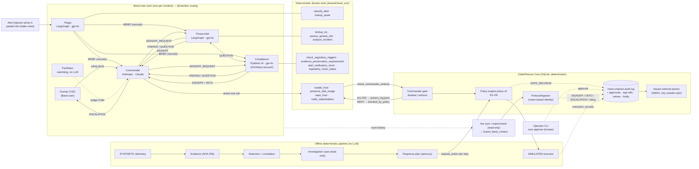

# 03 — Architecture diagram

Mermaid source (renders on GitHub and in VS Code with a Mermaid extension).
Solid arrows are messages or calls. Dashed arrows are records written to the Core.



## Plain-text fallback

```text
 Alert ──► Triage ──BRIEF──► Threat Intel ─┐   (all messages in ONE Band room,
                     │                     ├─FINDING/QUESTION──► Commander
                     └─────► Compliance ───┘                       │
          Commander ──SIGNOFF_REQUEST──► specialists ──SIGNOFF/VETO──┘
          Commander ──ESCALATION──► Human CISO ──ruling──► Commander
          Commander ──action tool──► Core gate ──► policy engine ──► ALLOW / DENY
                                                    │
 Band history ─(export-band, read-only)─(core import-band)─► ingestor ─► audit log ─► anchor
 SYNTHETIC telemetry ─► evidence ─► detection ─► investigation ─► plan ─► requests ─► SIMULATED executor
```

## Status of each arrow

| Arrow | Status |
|---|---|
| Agent ↔ agent messages, tool calls | Code present (upstream). Live run **UNVERIFIED** in this work |
| Action tool → Core gate → policy | **VERIFIED offline** (tests call the real Commander tool callables) |
| Band history → export-band → import-band | **VERIFIED offline with MOCKED Band clients.** Live **UNVERIFIED** |
| Live messages → Core *during* the run | `live sync`: **VERIFIED offline with MOCKED Band clients**; live **NOT VERIFIED** ([02 §6](02-system-design.md#6-live-integration-gap-and-how-it-is-addressed)) |
| Offline pipeline end to end | **VERIFIED offline** (see [08](08-test-verification-report.md)) |
